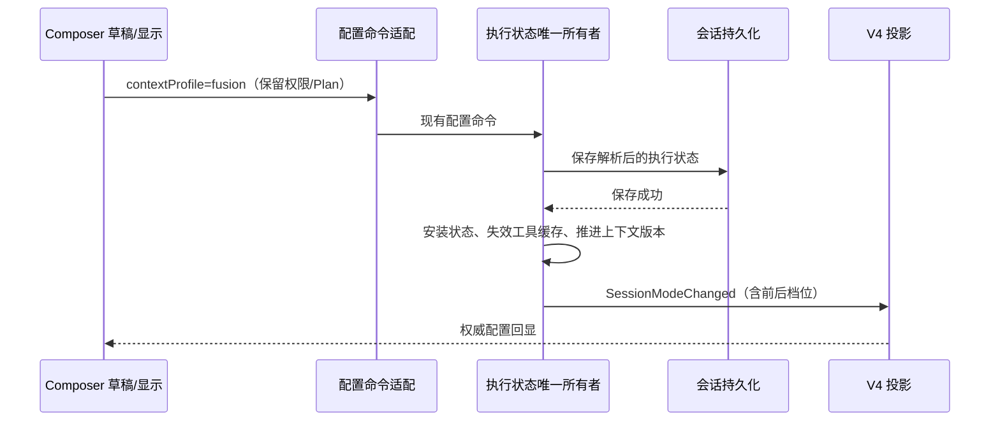

# 融合模式（Fusion Context Profile）

## 产品规则

融合模式是可选的行为/上下文档位 `contextProfile=fusion`，与执行权限 `mode`、计划状态 `planEnabled` 正交。它保持 ZCode 身份、权限、安全边界、桌面能力、技能、项目指令、记忆与工具集，只替换默认动态行为和上下文管理规则。默认仍为 standard；minimal 及旧 mode=minimal 兼容语义不变。

融合行为借鉴 Codex 的协作、授权内推进及任务连续性，Claude Code 的最小完整修改、有效委派和验证纪律，以及 ZCode 的桌面适配和自包含交付。不得冒充其他产品、引用不存在的工具或无条件继承其他产品的异步/代理能力。

分析与探索请求以有依据的评估为交付，不擅自实施；明确修改请求在授权范围内完成。计划模式只读和权限拒绝优先于推进规则。授权仅在同一范围内沿用；用户取消或改变方向时更新目标。交付物完成即结束，不按最后一段句式强制继续。

委派依据独立性、专用能力或减少无用原始输出的收益。单事实直接查；不重复已委派搜索，允许关键证据核验；继续不依赖结果的工作。仅在 Agent 可用时输出 Agent 相关指导。并行修改必须分清文件所有权。

融合模式不改变主代理/子代理身份边界。customSystemPrompt 和 workflowActor 使用各自身份契约，不注入融合交互行为；minimal 保持原互斥校验。输出风格可以改变呈现，不能移除权限或任务边界规则。

## 状态与接口

shared 的 contextProfileSchema 是档位值的唯一契约源。UI 仅拥有未提交草稿和乐观显示，runtime 拥有已生效执行状态。复用现有配置命令、会话配置、持久化及 SessionModeChanged 事件，不新增权限枚举或并行配置路径。

档位单独变化也必须保存、安装并发布事件；无变化才幂等早返回。保存失败不发布成功状态。忙碌输入在接纳时冻结档位；恢复/重放从持久化状态恢复，不由 UI 重建事实。

桌面实时链路和已有 Web 重放链路复用同一 owner、命令和事件，不新增远控模块。旧会话缺省档位继续按原兼容规则解析。执行端不支持融合档位时显式拒绝，不允许静默显示融合却按 standard 执行。

## 协议与能力协商

- shared 的 `contextProfileSchema` 扩为 `standard | minimal | fusion`，是档位值的唯一契约源；contracts/bootstrap 的本地 union 与双值判断改用该公共 schema/类型，不维护平行枚举。
- 新增 additive 能力位 `fusionContextProfile`（`zcodeRuntimeCapabilitiesSchema`、V4 `hostCapabilitiesSchema`）：只表达执行端支持融合档位。现有 `contextProfileState` 只证明 standard/minimal，不得用于放行 fusion。
- 当前 CLI 在 `runtime/capabilities` 与 V4 hello capabilities 中都宣告 `fusionContextProfile: true`。Host 服务对显式 `contextProfile=fusion` 的命令/创建/输入先经独立的 `ensureFusionContextProfileSupport` 检查，旧端缺失能力时报 `proto.fusionContextProfileUnsupported` 拒绝，不静默降级；standard/minimal 不做额外拒绝，`ensureContextProfileSupport` 语义不变。
- fusion 不引入 mode fallback：`resolveContextProfile`/`resolveExecutionState` 的旧 `mode=minimal` 兼容映射仍只产出 minimal，缺省仍为 standard。

## 界面

在现有权限菜单中提供互斥的普通上下文、极简上下文、Beta 模式（提示词融合模式测试版本，英文 Beta mode）选项，使用现有菜单组件、键盘语义与主题样式。描述明确提示“权限设置不变”。切换时必须可见当前档位，不仅依赖权限标签。中文/英文同时提供。

## 验收

- fusion 值在 shared/protocol/contracts 的运行时校验、输入、快照及恢复链路完整保留。
- 只切档位不会改变 mode/planEnabled；保存失败不安装；真正无变化不重复发事件。
- 融合提示词替换默认动态行为/收尾规则，不叠加冲突规则；普通和极简输出不变。
- 融合保留身份、安全、desktop、env、memory、skills、git 和项目规则；不存在的工具不被指导调用。
- customSystemPrompt/workflowActor 不受融合交互行为污染。
- 新任务草稿、会话切换、持久化恢复、输入提交都保留档位，默认 standard 语义不变。
- 旧执行端明确报不支持，不静默降级。
- 界面测试覆盖三态互斥选择、权限不变、描述和键盘/菜单行为；按可用环境检查深浅主题及窄屏。
- 静态和契约测试不证明模型行为提升；跨 GPT/GLM/MiMo 的任务质量对照属于后续行为评估，不将未运行评估报告为通过。
