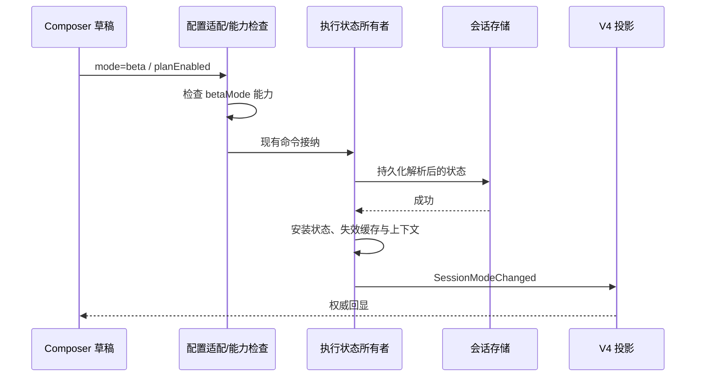

# Beta 模式（提示词融合模式测试版本）

## 产品规则

Beta 是独立工作模式 `mode=beta`，与变更前确认、自主模式、资料查询和完全访问互斥（极简模式入口已移除，仅保留历史会话读取兼容）。计划状态 `planEnabled` 仍是独立开关。模式菜单不再提供普通/极简/融合上下文三态选择；选中 Beta 时仅勾选 Beta，选择其他工作模式即退出 Beta。

Beta 使用完整上下文和现有融合行为提示词，保留 ZCode 身份、安全边界、桌面能力、技能、项目指令、记忆与工具集。权限明确复用完全访问（yolo）策略：减少确认次数，非 Plan 时与 yolo 同支直通。计划开启时仍只读；从 Beta 授予全权时保留 Beta，不因冗余授权退出。

融合行为借鉴协作、授权内推进、任务连续性、最小完整修改、有效委派、验证纪律及自包含交付。不得冒充其他产品或引用不可用工具。分析请求以评估为交付，不擅自实施；明确修改请求在授权内完成。权限拒绝、用户取消和计划约束优先于推进规则。

customSystemPrompt 和 workflowActor 保留各自身份契约，不注入面向主代理的融合交互行为。静态契约测试不能证明跨模型任务质量提升。

## 状态与接口

运行时拥有已生效执行状态；UI 仅拥有未提交草稿与乐观显示。复用现有配置命令、持久化和 SessionModeChanged 事件，不另建状态写入路径。

保存失败不得发布成功状态；真正无变化才幂等返回。忙碌输入在接纳时冻结状态，恢复和重放读取持久化事实。桌面连续链路与现有 Web 重放链路使用同一状态所有者，不新增远控模块。

## 历史兼容与能力协商

- 新 UI 写入 `mode=beta`，不再通过 `contextProfile=fusion` 选择 Beta。
- 保留旧 fusion 档位的读取兼容。任何权限与 fusion 的历史组合（含 build+fusion）都保持原权限，继续按历史语义执行，直到用户明确选择工作模式；**不把 build+fusion 自动升级为 Beta**——Beta 使用完全访问（yolo）权限，自动升级会静默改变旧会话的确认策略。`beta+fusion` 归一为 `Beta+standard`（Beta 强制完整上下文）。提交正文、同模式重申和恢复/读取边界都不算选择模式，不得借机清掉历史档位。
- 显式选择 Beta 时必须获得完整上下文和工具，不能继承旧 minimal/fusion 的过滤（任何来源的 beta+fusion 恢复值都归一为完整上下文）。真正切换到其他模式时清除遗留 fusion，防止退出 Beta 后继续使用融合提示词；菜单选择同时给出目标模式的规范档位（完整上下文为主），不遗留不可见的档位过滤；历史 mode=minimal 会话恢复时保留极简档位读取兼容，但不再提供极简可选入口。
- 增加独立 additive 能力位 `betaMode`。原有 `fusionContextProfile` 只证明历史档位支持，不能用于放行 Beta。
- 对旧执行端的 Beta 创建、配置、输入提交明确拒绝，错误为 `proto.betaModeUnsupported`，不静默降级到其他模式或继承当前自主权限。

## 界面与验收

- Beta 与其他工作模式同组单选，工具栏直接显示“Beta 模式”，不再显示为其他模式旁的档位徽标。
- 不出现“普通上下文”入口；极简模式不再提供可选入口（历史 minimal 会话保留读取回显）。
- 中英文说明标注提示词融合模式测试版本及默认确认机制。
- 测试覆盖模式枚举、能力拒绝、提交、状态投影、持久化恢复、旧 fusion 兼容、切换退出、计划只读和权限确认。
- 界面测试断言真实显示值，浏览器检查单选、退出、计划、深浅主题、紧凑和窄屏。
- 未运行的完整桌面端到端测试或跨模型行为对照不得报告为通过。
