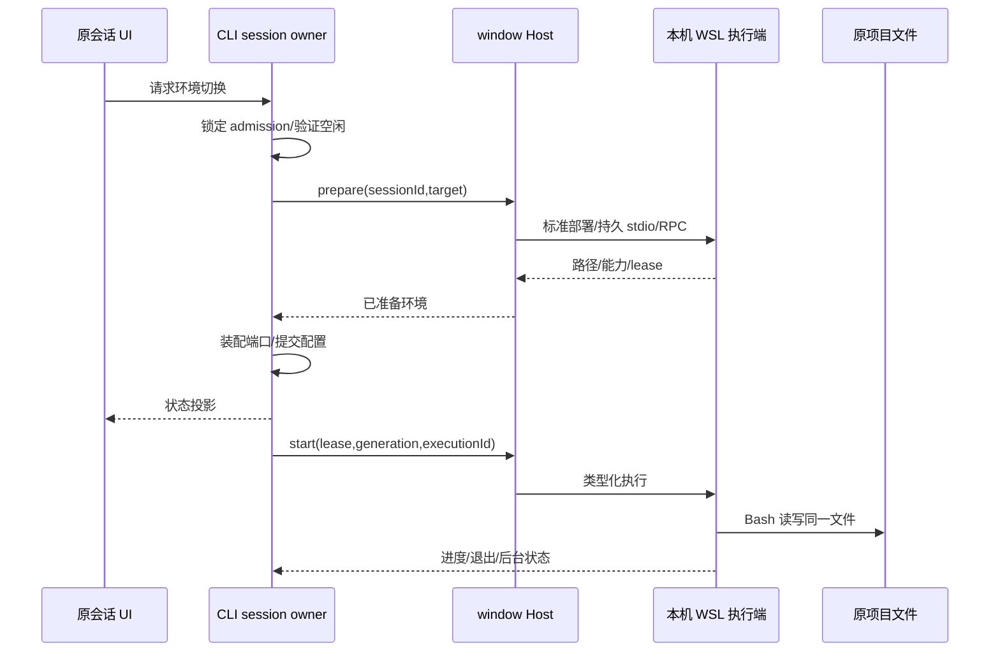

# 会话级本机 Linux 执行环境

## 产品规则

Windows 桌面的聊天会话可显式选择本机默认或本机 Linux（WSL）。Linux 是本机 WSL 进程，不需要外部服务器。模型、聊天数据库、sessionId、workspaceIdentity、Windows 项目文件真源不迁移。不同聊天即便同工作区也可选择不同执行环境。

首版不安装 Windows 功能/发行版，不修改默认发行版/用户、代理、防火墙或 .wslconfig，不启用 resident。WSL 未就绪时明确不可用。使用显式 distro/user；不能借用实验配置作为全用户默认。未指定环境保留现有行为。远程工作区不叠加本机 Linux 绑定。

Windows 项目经经验证的 wslpath 映射访问同一文件；不复制、双向同步或改写 shell 命令。源码在 Windows 挂载盘不承诺 ext4 性能。Windows/Linux 原生依赖混用必须提示；不自动覆盖 node_modules。会话工具目录与缓存在所选 Linux 用户 HOME 下受管目录。应用运行时准备幂等、版本校验、复用部署锁。未知项目脚本不是可信安装器；安装工具/依赖需明确命令及原有权限授权。首版不提供系统数据库/apt/sudo/systemd 通用安装器。

## 所有者及接口

- CLI session owner 是 executionEnvironment 配置唯一持久化/切换 admission 所有者。
- 窗口 Host 管理执行连接池、临时 session lease/generation、准备取消及进程回收；Main 仅转发/原生操作。
- Linux 执行端复用 NodeExecutionAdapter 和标准 Channel RPC，拥有前后台任务与输出文件。不能每条命令新建 wsl.exe 或采用 PTY 文本协议。
- Windows CLI App 按聊天 session 注入 ExecutionPort。共享工作区 Agent 进程不能因单会话切换重启。
- 配置仅保存 kind/distro/user，目录映射通过准备实时验证；不保存 PID、lease 或凭据。UI 只保留待提交状态。
- 连接复用与会话 lease 分离。执行、poll、取消、后台读取均验证 sessionId + lease + generation + executionId。旧代请求拒绝。断连明确失败，不回落本地。
- injected ExecutionPort 是借用端口，关闭/切换必须显式释放 lease。会话关闭不等于标签隐藏；其他会话资源不能被释放。
- 线格式使用明确的毫秒时间戳和字节编码；不跨 RPC 传 AbortSignal/function/Error 实例。runtime 合同中的 Date/Uint8Array 在适配器边界转换。

## 切换 admission

已有会话仅在无运行 turn、无排队/待接收输入、无阻塞交互和存活后台执行时切换。锁定 session admission 后准备新 lease，装配本会话新 App/端口，保留同一 session 历史、模型、权限与配置；成功后提交配置并释放旧 lease。失败保留原环境，准备取消不提交。不得重播用户输入，不做跨端数据库导入。恢复从持久配置准备新 lease，失败明确阻止执行。

## 路径及能力

控制端 Windows 路径与 Linux cwd 分离。只映射显式 path/cwd/argv 和 artifact，不对任意 shell 文本替换。Linux capture cwd 必须可回映射至授权工作区；不可映射/越界拒绝。环境变量不继承 Windows PATH 或模型 key。Linux shell selection 真实声明 POSIX；不能把整个 Windows runtime 冒充 Linux。

Bash/FileSystemPort 读取同一文件并维持 stale-write/revision 语义。内部搜索 prelude 不能把 Electron Windows command 发到 Linux；临时脚本、argv 可执行文件、输出上限、stdin、异常信号都须有能力检查。使用 ExecutionPort 的 hook、PDF、子 agent 必须遵守同一绑定，缺失能力明确错误。MCP、Browser/Computer Use 留在原控制端，不宣称自动迁移。若提供会话终端，必须绑定相同 lease/cwd/PTY，不能错误显示本地终端为 Linux。

宿主路径翻译（可选能力 `ExecutionPort.translateHostPath`）：控制端已有的宿主路径值（hook 命令与环境里的插件根/数据目录、项目目录、hook stdin 的 transcript 路径）在交给 Linux 执行前必须翻译成执行环境路径，权威来源与 cwd 映射同源（执行端 `wslpath`），不做字符串猜测；已是执行环境绝对路径的值不二次翻译；不可映射（网络盘/未挂载盘等）时显式失败并报出变量名与路径，禁止把宿主路径原样下发。本机目标下该能力返回原值（执行环境即宿主）。现场缺陷：官方插件 hook 命令 `python3 "${CLAUDE_PLUGIN_ROOT}/hooks/x.py"` 的 Windows 路径被原样交给 WSL shell，`C:\...` 被当相对路径拼到 cwd，脚本打不开退非零码、hook 被当作拦阻，Linux 会话每条 prompt 都被拦下。

## UI

会话内提供环境选项与准备对话框，展示发行版/用户/路径/运行时检查、进度、取消、失败重试、已准备工具。其他平台/远程会话隐藏或明确不可用。保留现有权限模式，不因选择 Linux 获得更大权限。工具安装入口显示明确命令、位置与权限，经正常用户输入/审批链执行；释放不删项目或依赖。

## 验收

- 默认本地行为不变；已有会话切换保留 ID、历史、模型、workspace identity。
- 同工作区 A/Linux 与 B/Windows 并存，cwd/env/output/取消归属不串；释放 A 后 B 继续。
- busy/queue/permission/background 状态拒绝切换，准备取消/失败不提交，恢复不降级。
- 前台、后台、Stop、timeout、输出上限、stdin、退出信号、断连、进程清理与旧 generation 拒绝。
- File Write → Linux Bash Read/Append → File Read 精确一致，空格/中文/引号路径及尾换行，非法/越界路径。
- 严格 wire 校验、秘密不入日志、不传 Windows Provider/无公网监听。
- 真实 WSL + 独立桌面免费回放 E2E；主 Preview、主构建、已有手动测试实例及无关改动不动。
- 测量首次准备、热命令、文件密集、连续工具轮次和完整任务，分别报告；挂载盘无收益也如实记录。

本阶段只实现/验证，不提交、推送。没有容器级安全隔离承诺，不恢复退役功能。
