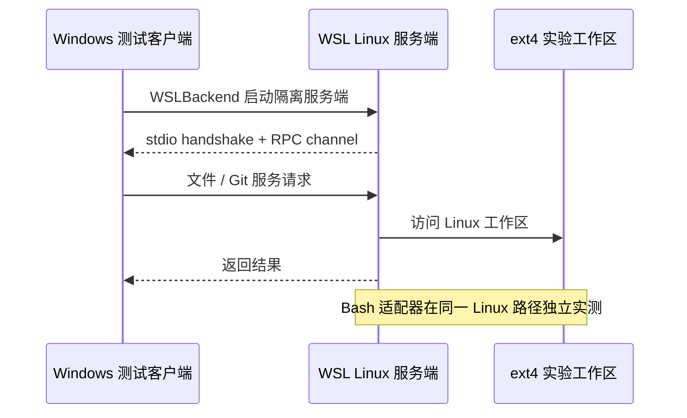

# WSL2 加速 Agent 终端执行：第一阶段实测报告

日期：2026-10-16。源码基线：`253d39fc11032007f38c66b7b6cffe7e16143274`，应用版本 3.15.1。

## 结论与决策

**值得沿用现有 WSL 工作区路线。** 本机实测，真实 `NodeExecutionAdapter` 的热态短命令从 Windows Git Bash 的 **82.9–88.0ms** 降至 WSL Linux 内部的 **16.2–16.7ms**，约 **5.0–5.4 倍**。计时包含适配器准备、输出落盘和 cwd 捕获。两轮数据均支持这一方向。

收益需要让执行运行时在 Linux 内持续运行，并把源码、依赖和缓存放在 Linux ext4。Windows 每次经 `wsl.exe` 调用一条 Linux 命令，本轮中位数为 **107.5ms**，高于 Windows 原生非登录 Shell 的小输出样本 **54.9ms**。不建议把逐命令 `wsl.exe` 包装作为加速实现。

这不是整体 Agent 快 5 倍的结论。所选 21 项 RPC 单测进程约快 18%；TypeScript 类型检查和编译在最终轮基本持平，前一轮还略慢。模型生成、网络、工具业务逻辑、CPU 重任务和桌面交互未被上述适配器计时覆盖。

建议下一阶段完善现有 WSL 工作区体验与真实 Agent 验收，再评估默认推荐策略。本阶段只增加研究脚本、规格和证据，没有切换默认执行后端、修改 UI 或权限行为，也没有开展第二阶段产品开发。

## 实验边界与环境

| 项目                 | Windows                                   | WSL2                              |
| -------------------- | ----------------------------------------- | --------------------------------- |
| OS                   | Windows 10.0.26100（Windows 11 构建系列） | Ubuntu-24.04，WSL 2.7.10          |
| 内核                 | Windows 10.0.26100                        | 6.18.33.2-microsoft-standard-WSL2 |
| CPU                  | Ryzen 7 H 260，16 个可见逻辑 CPU          | 同一宿主，8 个可见逻辑 CPU        |
| 可见内存             | 15.26GiB                                  | 9.71GiB                           |
| 最终环境快照可用内存 | 约 5.32GiB                                | 约 9.18GiB                        |
| 文件系统             | C 盘 NTFS                                 | Linux ext4，statfs type 61267     |
| Node / pnpm          | 24.14.0 / 10.33.2                         | 24.14.0 / 10.33.2                 |
| Git                  | 2.50.0.windows.2                          | 2.43.0                            |
| Bash / rg            | Git Bash / ripgrep 14.1.1                 | /bin/bash / ripgrep 14.1.1        |
| TypeScript / Vitest  | 6.0.2 / 4.1.4                             | 6.0.2 / 4.1.4                     |

Windows 实验副本：`C:/Users/qianmengyys/Desktop/agent/wsl-agent-lab/windows-workspace`。
Linux 实验副本：`/home/ftuser/zcode-agent-lab/linux-workspace`。
两侧都是上述固定提交；每侧 17,004 个 tracked 文件。Windows 原有未提交改动未进入副本。

两侧 Git 版本、可见 CPU/内存、宿主负载和缓存状态有差异，因此这是一台机器上实际可用环境的对比，不是只改变 OS 的严格单变量实验。没有关闭其他日常应用、清空 OS 页缓存、调整虚拟机资源或监控每个样本的系统级 CPU 竞争。Windows 与 Linux 测量串行执行，期间不并行运行依赖安装、服务端构建或其他基准。

依赖均按锁文件独立安装并使用 `--ignore-scripts`，未复制 Windows node_modules 到 Linux。Windows 安装记录为 36.8s、复用缓存 2060 项；Linux 为 174.5s、下载 2038 项。这是准备成本，缓存条件不同，**不能用来判断安装性能**。hoisted 工作区布局导致即使筛选样本所需包，仍安装了约 2,400 个平台相关依赖。没有执行 node-pty 的 Linux 安装脚本，因此终端 PTY 不在本轮覆盖范围。

## 测量方法

- Shell 计时：Node 异步 spawn 到进程结束，使用 `performance.now()`。非登录模式显式 `--noprofile --norc`；登录模式 `-l` 的配置开销单列。
- 适配器计时：两侧加载同一 SHA-256 的 bundle，从 `@zcode/adapters/exec` 公开源码入口打包。墙钟包围 `await port.run(request)`，不使用内部 `durationMs` 代替外部耗时。每次新建 request，启用 cwd 捕获和输出持久化。
- WSL 包装计时：Windows Node → wsl.exe → Linux Bash → marker。Linux 内部基准只跨界启动一次，样本循环全部在 Linux 内执行。
- 短命令每场景 30 个样本；工作区操作 5 个；开发任务 3 个。Shell/task 先预热一次；适配器首次真实调用单独记录 1 次，其后为热态样本。
- 只在 n≥20 时给出 P95。中位数、最小/最大值及全部原始样本见 JSON；低样本开发任务不作精确排名或显著性结论。
- 非零退出、超时、超限、cwd/输出不符计为失败。最终 Windows/Linux 主基准均 exit 0，`failures=[]`；超时、取消和后台探针均通过。
- 编译关闭 TypeScript incremental/composite 缓存；构建输出在工作区外。仍保留正常 OS 文件缓存，结果属于预热后的开发执行。

## 最终对照数据

单位 ms；除适配器首次调用外，表格数值均为中位数。“比值”是 Windows 耗时 ÷ Linux 耗时，大于 1 表示本轮 Linux 更快。

| 场景                     | 每侧 n |   Windows |     Linux |     比值 |
| ------------------------ | -----: | --------: | --------: | -------: |
| Shell 空命令，非登录     |     30 |     68.40 |      2.22 |    30.87 |
| Shell 小输出，非登录     |     30 |     54.85 |      1.99 |    27.50 |
| Shell 管道 grep，非登录  |     30 |    139.38 |      3.68 |    37.86 |
| Shell 空命令，登录       |     30 |    460.50 |     20.25 |    22.74 |
| Shell 小输出，登录       |     30 |    462.25 |     19.86 |    23.28 |
| Shell 管道 grep，登录    |     30 |    488.05 |     21.16 |    23.07 |
| git status，干净工作区   |      5 |    125.59 |     35.60 |     3.53 |
| git ls-files             |      5 |     91.42 |      7.97 |    11.48 |
| rg 固定 8 个源码文件     |      5 |     85.84 |      6.56 |    13.08 |
| rg 固定 3 个目录         |      5 |     95.83 |     15.36 |     6.24 |
| 适配器首次调用，单个观测 |      1 |   1139.73 |     80.36 |    14.18 |
| **适配器热态空命令**     | **30** | **82.88** | **16.71** | **4.96** |
| **适配器热态小输出**     | **30** | **88.01** | **16.20** | **5.43** |
| RPC 单测，21 项          |      3 |    607.21 |    512.50 |     1.18 |
| RPC 类型检查，非增量     |      3 |    595.15 |    601.62 |     0.99 |
| RPC 编译，非增量         |      3 |    723.65 |    715.25 |     1.01 |

适配器热态空命令 P95：Windows 107.47ms，Linux 18.00ms。
适配器热态小输出 P95：Windows 105.22ms，Linux 19.46ms。

逐命令 `wsl.exe` 包装路径：n=30，中位数 **107.48ms**，P95 **115.04ms**，范围 **103.22–126.95ms**。首次观测 123.53ms。没有强制停止/重启 WSL，**此首次观测不是 VM 冷启动**。适配器首次调用也只代表新适配器实例的初始化，不代表整个 Server 或 Agent 的冷启动。

之前一轮适配器热态中位数为 Windows 83.18/87.33ms、Linux 16.31/16.42ms，与最终轮方向一致。该轮 Windows 部分源码为 CRLF，后发现输入不完全逐字节一致，故报告采用统一源码后的最终轮作为主结果。两轮 TypeScript 类型检查/编译比值分别约 0.92/0.89 与 0.99/1.01，**没有稳定加速证据**。

按最终适配器样本估算，100 次串行短命令可减少约 6.6–7.2 秒执行等待；这是局部算术估计，不是一次真实 Agent 任务的测量结果。

## 正确性与证据

Windows 初次 clone 继承 `core.autocrlf=true`。设置 false 不会自动重写所有已有文件；最终使用固定 HEAD 的 Git archive 重写本轮拥有的副本，再以 `git add --renormalize .` 刷新索引。暂存区 diff 与工作区 status 均为空。两侧完整 tracked-file manifest 的内容哈希一致：

`8af3c0e01d6fa4622e219432c8818a24e264dfd24f8ca761d09b14a3ac1090cf`

因此 17,004 项的文件名、长度与逐文件 SHA-256 均一致。符号链接比较其目标字符串字节；Windows `core.symlinks=false` 的检出文件存储相同目标文本。

`git ls-files` 两侧原始输出相同。最终 rg 小文件输出均为 2539 bytes，大目录结果均为 27539 bytes；raw SHA 仍可能不同，因为多线程搜索输出顺序不同。将本夹具输出按换行/路径分隔符规范化后排序，两侧 canonical SHA 均一致；这仅证明本夹具结果等价，不泛化为任意源码语义等价。

两侧额外后台输出检查均成功：后台任务自然结束，合并落盘文件包含 stdout 的 `first-marker` 与 stderr 的 `second-marker`，最终状态为 completed。主基准另外验证了 timeout、AbortSignal 取消和后台任务登记/取消。没有进行整套平台适配器回归或沙箱策略等价性验收。

适配器 bundle SHA-256：`fd7ae520c31b7ac96370a10a2c0162552cfc94320ddbf6c7b89d496f272063dc`。
两侧使用完全相同的 bundle；基准脚本哈希记录在 [comparison.json](wsl-agent-benchmark-data/comparison.json)。

## WSL 连接验证

使用现有 `WSLBackend`、stdio handshake、RPC protocol/channel 和服务访问实现，启动独立目录中的服务端。为保护共享 `~/.zcode/server`，启动命令使用实验专属 bundle/runtime/data/HOME；没有直接调用标准 `connectRemote → deployServer` 入口，其部署路径在当前实现中固定为 `~/.zcode/server`。

服务端 bundle 从固定提交的干净实验副本新构建，沿用 `packages/server/build-remote.ts` 的 esbuild 配置，验证通过，记录 1155 个输入哈希及 metafile；fresh 产物与原本本地 dist/mock-cdn 产物同哈希。ignored 产物的相同哈希本身不能证明 Git 源码一致，此处依据实际重建证据标记 `verified-by-build`。

fresh server SHA-256：`f41522627d1fc21394cf6d1aa2a514e43ee1245b09401f1e298b8c95f3f88025`。
握手报告版本 3.15.1，以下 5 项 RPC 全部通过：

- 文件目录列举与 package.json 读取。
- Git 仓库摘要与本地分支列表；远端仓库路径正确且 isDirty=false。
- 系统信息；HOME 返回实验隔离目录。

一次探测总耗时 2576ms；从测试驱动起始累计到握手完成 1857ms、RPC channel ready 1858ms、全部 RPC 完成 2563ms、dispose 2564ms。这是单个探测，包含客户端准备、身份解析和多个跨界操作；不是稳定连接时延、首次部署耗时或 VM 冷启动成绩。服务端进程已回收。

**未覆盖**标准自动部署/更新、桌面 GUI 连接、终端 node-pty、真实模型驱动的完整 Agent 工具轮次、断线重连和任务恢复。未调用付费模型、未复制主实例凭据。Bash 与文件 RPC 使用同一 Linux 工作区，但没有把它们串成一次模型会话来测量。

## 落地建议

1. 优先完善现有 WSL 工作区：Windows 桌面保留 UI，Linux 内运行 Server/Agent/Bash；文件、Git、搜索和执行工具统一拥有 Linux 工作区。不要只把 Bash 代理到 Linux，再让其他文件工具操作 Windows 的另一份副本。
2. 先为 opt-in WSL 路径补齐标准部署、终端依赖、无凭据独立桌面验收、输出回收、取消/进程树、断线恢复和真实工具轮次计时，再决定是否推荐默认启用。当前 SSH resident 规格不覆盖 WSL；连接期间运行的 Linux 服务端不能据此宣称具备断开桌面后持续任务的 resident 能力。
3. 同时保留本机优化：Shell 初始化/快照与 Git Bash 子进程成本仍值得改善。Windows 桌面构建、打包和平台专属验收留在 Windows。
4. Docker 暂不引入，后续仅按复现/隔离需求评估。just-bash 是模拟 Shell/虚拟文件系统，本轮没有安装或测试；不能将其视为支持任意原生程序的真实 Linux 替代。

## 检查与交付

- Windows 与 Linux：相关 Node 测试各 **10/10** 通过，无 skip。
- 全量 `pnpm lint`：exit 0，83 warnings / 0 errors；警告为已有代码基线。本轮脚本局部 Lint 无警告/错误。
- `pnpm architecture:check --changed`：exit 0，0 violations。
- 全量 `pnpm typecheck`：exit 2，仍是已有 `packages/desktop/test/e2e/settings/fork-feature-acceptance.test.ts` 的 3 处错误：L8 缺少 shared.sel 导出，L54/L84 HTMLElement 与 string 不匹配。本轮没有修改该测试，不能将全量类型检查写成通过。
- freshness 联网 fetch 受连接重置限制；缓存引用 `--no-fetch` 检查通过，不等同已同步远端最新状态。
- 本轮代码范围格式、语法及 diff 检查通过；详细检查记录与原始结果见 [数据索引](wsl-agent-benchmark-data/README.md)。

完整数据、复跑命令与方法分别见 [数据索引](wsl-agent-benchmark-data/README.md)、[复跑说明](wsl-agent-benchmark-data/reproduce.md) 和 [基准规格](wsl-agent-benchmark.spec.md)。

实验副本、依赖、工具与输出保留以便复跑；两侧 node_modules 约各 2.5–2.6GB，另有工具、源码和下载/包缓存。本轮没有修改 .wslconfig、默认发行版、系统代理，没有 shutdown WSL 或终止/覆盖运行中的 Preview，没有提交或推送。原有图标修复及其他无关改动保持原状。
