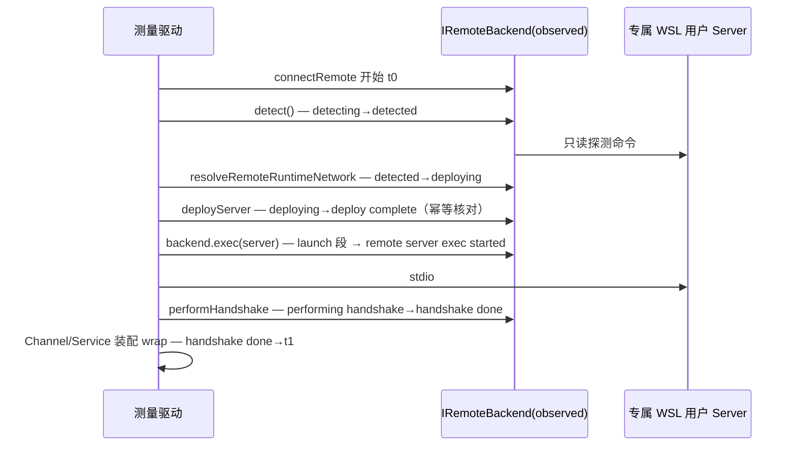

# WSL 连接耗时分解测量规格

状态：已批准实施（阶段三首步）。前置：`wsl-workspace-acceptance.spec.md`（第二阶段全链路已通过）。

## 目标与边界

把标准 `connectRemote` 的连接墙钟分解为 detect / runtimeNetwork / deploy / launch / handshake / wrap 六段，找出热连接 16–21 秒的真实去向，为是否做常驻/预热/并行化提供数据依据。

本步**只测量、不改产品行为**：不引入 resident、不改部署语义、不改握手协议。允许测试侧 backend observer 包装（延续第二阶段规则：只观察，不改变 exec/upload 语义）与 console 日志时间戳捕获。

## 阶段定义（状态所有者与时序）

连接初始化由 `connectRemote` 拥有；驱动只拥有自己创建的 connection/backend 生命周期。阶段边界取自 connectRemote 现有日志标记：

| 阶段             | 边界                                                                                 |
| ---------------- | ------------------------------------------------------------------------------------ |
| detectMs         | `detecting remote env...` → `detected:`                                              |
| runtimeNetworkMs | `detected:` → `deploying server...`                                                  |
| deployMs         | `deploying server...` → `deploy complete`                                            |
| launchMs         | `deploy complete`（缺省 `launching remote server...`）→ `remote server exec started` |
| handshakeMs      | `performing handshake...` → `handshake done`                                         |
| wrapMs           | `handshake done` → connectRemote 返回                                                |
| unattributedMs   | 总墙钟减去已归因段（含调用前隙与 execStarted→handshaking 小隙），不得虚减            |

标记缺失时对应段为 `null`，缺口计入 unattributed，不用估算填补。

## 测量口径

- **warm（幂等部署）与 cold（空运行时首装）分列**。本步测 warm N 次；cold 只允许真实空 HOME 场景产生（first-deploy 已有单样本 21.18s），禁止删除运行时伪造冷态。
- n≥20 才给 P95；探索轮次（n<20）只报 min/median/max/mean。第二阶段 16–18s 为低样本观察，本测量用于定位去向而非重述其分位数。
- 每次迭代前释放上一连接（disposeAndWait + backend dispose），迭代间固定 500ms 间隔并记录。
- 校准项：同 distro/user 的 `wsl.exe --exec true` 裸往返 5 次，用于解释单条 backend.exec 的固定跨界成本。
- backend observer 记录 detect/exec/upload/exists/existsMany/readFile/readFiles 的起止与 detail。批量调用只记外层一次（不把内部逐项或 shell 调用重复相加）；这是 API 调用次数，不是底层 wsl.exe 进程启动数。2026-10-16 第二批优化前补齐批量方法计数，旧 after-batch 数据漏计 3 次 existsMany，应保留原始数据并在报告更正，墙钟数据不受影响。detail 里 `*TOKEN*/*SECRET*/*PASSWORD*/*CREDENTIAL*/*APIKEY*=...` 一律替换为 `<redacted>`，并截断到 240 字符。日志不写凭据。
- 失败即停但保留已测迭代；finally 只释放本轮 connection/backend。

## 驱动与产物

- 纯函数支持模块：`packages/server/scripts/wsl-connect-latency-support.ts`（参数扩展、阶段归因、detail 脱敏），单测覆盖。
- 主驱动：`packages/server/scripts/wsl-connect-latency.ts`，复用 smoke 的 `parseSmokeArgs`/`resolveEffectiveAssetsRoot`，opt-in、非 Windows 或无 WSL 明确 skipped。
- 机器运行器：lab `phase3/run-connect-latency.mjs`（同 run-smoke.mjs 的 tsx loader 用法）。
- 结构化结果：`wsl-connect-latency-result.json`（per-iteration + aggregate + calibration + exec 调用汇总）。

## 验收

1. 单测覆盖归因（全标记/缺标记/空标记）、脱敏、`--iterations` 参数校验。
2. warm N=10 实测产出结果 JSON，六段之和与总墙钟的差额全部落在 unattributedMs，无虚减。
3. 根据最大段给出优化建议方向（常驻/预热/并行/协议），但**不在本步实施**；任何产品改动另立 spec。
4. lint/typecheck/相关测试通过；既有失败单列。
