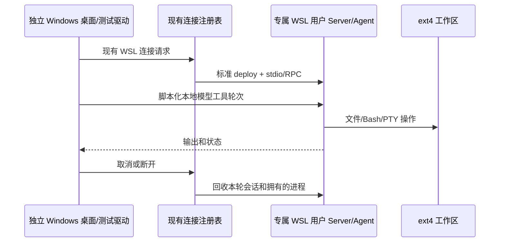

# WSL 工作区第二阶段验收规格

状态：已批准实施。基线 253d39fc11032007f38c66b7b6cffe7e16143274。

## 范围

复用现有 WSL RemoteTarget、标准 connectRemote/deployServer、服务 RPC、桌面连接与 Agent 工具。新增 opt-in 测试和实验驱动；仅修复已复现的问题。不新增执行后端、部署根配置、默认 WSL 或 resident 行为。

测试使用 Ubuntu-24.04 专属非 root 用户与其 HOME/ext4 工作区；用户密码锁定、不加入 sudo。主 ftuser HOME、主桌面数据、主 dist、运行中 Preview 和无关工作区改动不属于写入范围。

## 状态所有者与顺序

连接注册表拥有连接、Server/Agent 拥有任务，文件工具与 Bash/PTY 操作同一个 workspacePath。测试仅观察真实结果，不另建产品状态或伪造成功。

## 标准连接驱动

- 显式 distro/user/workspace/assets/output，所有本地路径绝对；非 Windows 或未启用的自动测试明确 skip。
- 必须走公开 remote 入口的 connectRemote，skipDeploy=false；不通过手写启动命令替代标准部署。允许测试 backend observer 包装，但禁止改变部署/exec 的语义。
- 本地资源固定为 fork 相应产物；核验 node/server/Agent/node-pty SHA-256 与版本。禁止官方远端下载替代 fork。
- 首次安装、二次连接、握手/RPC墙钟分别记录；低样本不声明稳定延迟。
- 校验隔离用户/HOME、文件读写、Git；真实 PTY marker、pwd、文件改写与结束状态。
- 支持取消连接与断线/重新连接，按 stdio 语义回收，不声明断开后持续任务。
- finally 只释放本轮资源，失败退出非零，结构化结果明确 passed/failed/blocked/skipped，不记录 env 全集、凭据或真实模型 key。

## 桌面与 Agent 轮次

- 独立源码副本/构建输出、HOME/userData，保留主 Preview；使用现有桌面 E2E 启动和 UI WSL 入口。
- 本地免费模型 fixture/replay，验证端点从 Linux 实际可达，不依赖 NAT 下 localhost 假设；不使用主凭据或付费服务。
- 文件工具写 marker → Bash 读并修改 → 文件工具读取修改内容，结果必须在同一 ext4 路径；必须实际收到工具结果并完成后续模型响应。
- 核对窗口工作区 identity/session、首发与续发、取消长命令及后台输出状态。
- 桌面启动器预置的 Windows replay provider 必须在首发前显式替换为 Linux loopback endpoint，并核对 Personal Config 与实际请求阶段。仅修改 worker 环境变量不会更新已存在的 provider。该 opt-in 用例的 WDIO 外层预算覆盖部署、工具轮次和 finally；用例内 this.timeout 不能替代 adapter 的外层预算。
- PTY/连接取消/回收与 Agent 层级独立记录；协议通过不能冒充桌面 UI 或模型会话通过。

## 已复现问题的验收规则

- RPC 同一个事件函数允许取消最后一个监听器后再次订阅；客户端必须恢复该订阅的响应分发，不能仅发送 EventListen。取消期间不再投递，重新订阅后新事件可达。WSL 真实 PTY 首次输出成功、第二次复用事件函数订阅为空的记录是该回归的外部证据。
- PTY 输出包含 ANSI 控制序列，cwd 通过命令生成的唯一标记字段验证，不依赖提示符或整行纯文本。Ctrl+C 后 Bash 可能丢弃当前命令行剩余语句；应观察子进程退出并另发命令验证 shell 仍可用。
- 首次部署、已有资源的标准重连与热态命令基准分别记录。开发态桌面还需具备源码侧官方插件的生成产物；仅复制 Agent bundle 不代表完整开发态部署闭包。

## 文件与检查

新研究规格/报告位于 docs/research；标准集成驱动位于 packages/server/scripts（由该包公共 remote 入口访问）；桌面 opt-in 用例/helper/fixture 位于 packages/desktop/test/e2e。实验准备与机器相关驱动保存在 wsl-agent-lab/phase2，所有新资源记录清单。

变更前读取适用规范、架构上下文；新缺陷先留复现与规格，再最小修复和回归测试。运行相关测试、pnpm lint/typecheck、格式、架构和diff检查。全量既有失败单列，不改无关代码隐藏失败。不提交推送。
