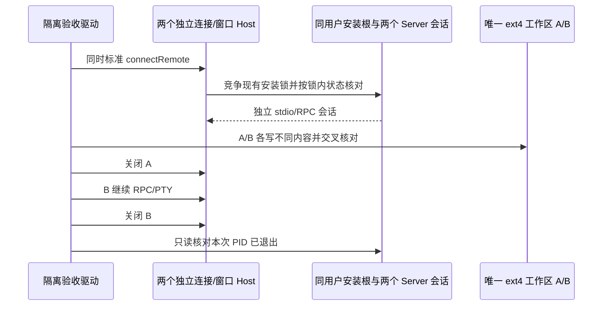

# WSL 工作区剩余验收规格

日期：2026-10-16。前置：第二阶段完整桌面验收与阶段三两批连接优化。用户批准一次完成剩余验收，真实模型限定 WorkBuddy 反代 `new-provider-2/cn:step-5-preview`。

## 范围和所有者

- 标准连接、安装锁、部署决策仍由现有 connectRemote/deployServer 拥有；测试不得 skipDeploy、复用 dispose 后的 backend 或替换产品握手。
- 测试仅拥有其新建连接、专属用户下唯一目录、PTY 和子进程；不改默认 WSL/系统网络，不关闭发行版，不动其他用户进程。
- Provider 只读取指定规则，用于指定模型；不输出 access/header/baseUrl，不复制主用户整个配置。凭据仅存在未跟踪私有材料/内存；归档只含 provider/model 标识、脱敏结果与 usage。
- 双连接 RPC 验证不冒充双窗口 UI；免费回放不冒充真实外部模型；30轮短时循环不冒充24小时长稳。

## 场景与判据

1. **30轮连接循环**：每轮新 backend，标准部署连接、核验用户/HOME、同一 ext4 文件经 RPC 写入和 PTY 修改后 RPC读回、释放 PTY及连接；下一轮验证上轮文件持久。记录 connect/close 耗时、server PID/RSS/fd及回收结果。必须30/30通过，无吞错；统计中明确时间跨度，P95仅用于这30轮探索样本。周期性执行真实长命令Ctrl+C与detect中取消。
2. **并发连接**：至少5轮同时创建两个标准连接，共享安装根、独立workspace。验证两组PID不同、同一路径名内容隔离；关闭A后B继续文件和PTY操作，最后只观察本轮PID均退出。记录并发连接耗时。保护安装锁重检边界。
3. **桌面并发UI**：两个独立 HOME 桌面实例连接A/B，验证identity/session隔离和各自完整工具/取消/关闭重连。记录实际重叠时间及关闭先后；只有观察到一方退出后另一方继续操作，才声明该隔离性通过。同一应用双窗口另列：当前主窗口协调器复用已有主窗口，没有公开 New Window 入口，记 unavailable，不新增产品功能。
   - Provider 是远端用户级配置，两个客户端向同一用户同步同一个 provider ID 的不同端点会相互覆盖；不宣称配置按连接隔离。并行免费回放必须使用同一 Linux loopback 入口，按请求里的唯一 runId 路由到各实例的真实 replay。测试专用 router 仅监听 127.0.0.1，只允许注册本机端口，未匹配/多匹配请求拒绝；不伪造工具结果，不改产品配置所有权。
   - 既有连接取消检查按专属用户 before/after PID 比较；双实例各自取消检查结束后才一起进入正常连接，防止把另一实例的合法 server 当作泄漏。屏障是文件/状态条件，不用延迟假定取消完成。
4. **环境矩阵**：枚举已安装发行版、当前专属用户、不同用户名解析和目录特殊字符；只使用已授权隔离用户。不把docker-desktop视作通用发行版，不改默认用户。未安装发行版记unavailable。loopback探测至少重复10次并记录Windows与Linux端结果，不修改转发配置。
5. **真实step工具轮次**：指定模型通过真实Agent执行Write→Bash验证/追加→Read；检查模型工具结果、最终助手答复和独立文件读回，不仅做HTTP问答。不转用其他模型；失败如实保留错误层级。可有界续发及取消验证，不设置自动无限费用任务。
6. **工程收尾**：相关测试、typecheck/lint/architecture/格式/diff通过，提供opt-in使用说明、故障边界与可复跑入口，按功能整理本地提交；不推送，保留无关改动。

## 产物

机器实验脚本位于已保留lab的phase4，归档证据位于 `docs/research/wsl-workspace-stability-data/`，报告 `wsl-workspace-stability-report.md`。每项状态为passed/failed/unavailable/not-run，记录真实原因与适用边界；只有全部实际覆盖项通过才建议该固定环境opt-in使用。
