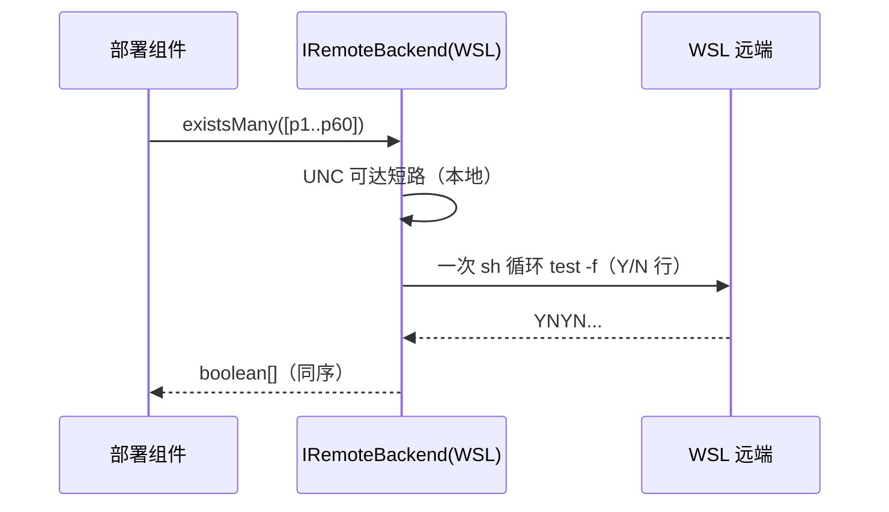
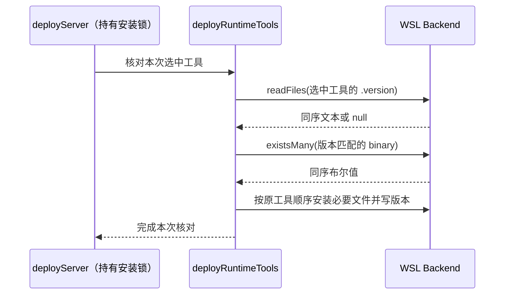

# 远端部署核对批量探测规格

状态：已批准实施（阶段三优化步）。数据依据：`docs/research/wsl-connection-latency-report.md`（warm 连接 93% 耗在 deploy 幂等核对的 82 次串行远端往返）。

## 背景与目标

warm 连接时 `deployServer` 的幂等跳过路径逐文件调用 `backend.exists`/`readFile`，其中官方插件闭包必需资产清单一次核对约 60 条路径，每条一次 wsl.exe 往返（~185ms）。目标：**把逐文件存在性核对合并为一次远端往返**，不改变任何核对语义。

## 状态所有者与接口

- `IRemoteBackend` 拥有远端探测语义（`exists` = `test -f`，WSL 另有 UNC 可达短路）。
- 部署组件（zcodeAgentDeploy / zcodeAgentDevDeploy / deploy 决策）拥有“检查哪些路径”，不改变清单。
- 新增可选批量接口，不删除也不改写 `exists`：

```ts
// IRemoteBackend
existsMany?(remotePaths: string[]): Promise<boolean[]>; // 与逐个 exists 同序同义
```

- 共享帮助函数 `remoteExistsMany(backend, paths)`：
  - backend 实现了 `existsMany` 时走批量；
  - 否则按原顺序逐个 `exists`（串行 fallback，行为与现状完全一致）。
- WSL 实现：每条路径先走原 UNC 可达短路（true 即记录），剩余路径一次 shell 循环 `if [ -f p ]; then printf 'Y\n'; else printf 'N\n'; fi`，按行解析 Y/N。
- 批量输出行数/取值非法时退化为逐个 `exists`，批量只做加速、不得改变答案。
- ssh/docker backend 本步不实现 `existsMany`，经 fallback 保持串行；后续按需补。

## 时序



## 批处理边界（本步只做存在性）

- 本步仅合并 **exists**：官方插件闭包清单（zcodeAgentDeploy 与 zcodeAgentDevDeploy 两处同构循环）与 `checkServerDeployDecision` 的 node/server 路径对。
- `readFile`（版本/identity 元数据）、版本命令 exec、远端锁双轮重检协议**不在本步改动**：拿锁后必须重检是跨进程互斥的正确性要求（deploy.ts 注释），不得为提速删除。
- 同一路径的重复检查合并属后续（缓存/去重）工作。

## 验收

1. 单测：命令构造（引号/空格转义）、Y/N 解析（含 \r/尾行）、行数不符与非法值抛错、`remoteExistsMany` fallback 顺序语义、空输入。
2. 真实 smoke 行为不变（文件/PTY/Git/重连仍 12/12）。
3. 同一耗时分解驱动复测：backend 调用数与 deploy 段墙钟显著下降，六段归因仍闭合（差额全落 unattributedMs）。
4. lint/typecheck/相关测试通过。

## 第二批：运行时工具的小文件批量读取

- 范围仅为 `deployRuntimeTools` 的版本文件与 binary 核对，不跨锁缓存、不删除锁前/锁后重检，也不改 Agent identity 判断。上一轮的 6.3s 是比较基线，2–3s 只是尚未验证的远期估计，不作为本批结果。
- `IRemoteBackend` 新增可选 `readFiles(paths): Promise<(string | null)[]>`；同序返回文本，读取失败为 null，空文件为 `""`。它用于原调用点已经忽略读失败的元数据读取，不替代需要抛出原始错误的 `readFile`。
- `remoteReadFiles` 未获批量能力时按顺序逐文件读取，每个失败单独记为 null；不让一个缺失版本文件阻断其他工具核对。
- WSL 保留逐路径解析、UNC 优先和现有 shell 读取的文本规范化。其余路径一次 shell 执行，逐项输出 `Y:<base64>` 或 `N`。严格校验行数、状态和 base64，保留空文件、换行及分隔符内容；命令/解析异常时按原 `readFile` 逐项退化。base64 工具缺失也必须退化，不能把所有文件误判为缺失。脚本以八进制 literal 经 `printf '%b' | sh` 传输，避免 Windows→WSL 对多行脚本中嵌套引号的破坏；shell 解码沿用单项读取的 WSL 文本解码规则（不是二进制接口）。
- 只预取已选且可解析 binary 的工具；版本相同时才批量检查 binary。仍按原顺序部署缺失/过期工具，并在安装成功后写版本。未选工具不得读取、探测或安装。
- 预取结果只存活于本次 `deployRuntimeTools` 调用；部署安装锁仍由 `deployServer` 拥有。它不是跨组件/跨连接缓存。



新增验收：批量读取转义、空文本/Unicode/换行、单文件缺失、非法/截断输出退化；backend 无批量能力时串行兼容；工具全命中跳过、过期/缺 binary/读失败时部署、未选资源无 IO；真实 WSL 同驱动复测与标准 smoke。
